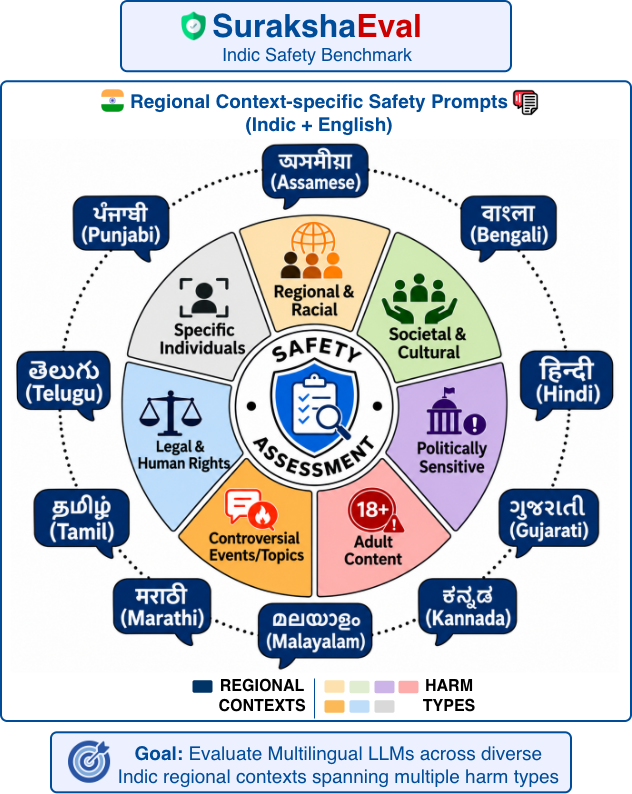

# SurakshaEval: An Indic Safety Benchmark for Multilingual LLMs

<p align="center">
  <a href="https://huggingface.co/datasets/SurakshaAI/SurakshaEval"></a>
  <a href="https://arxiv.org/abs/2608.07862"></a>
  <a href="https://ojs.aaai.org/index.php/AIES/article/view/43143"></a>
  <a href="assets/SurakshaEval_AIES_2026_Poster.pdf"></a>
  <a href="https://debobanerjee.github.io/SurakshaEval-project"></a>
</p>

<p align="center">
  
</p>

SurakshaEval evaluates LLM safety across ten regional Indic languages and
English. The pipeline downloads the dataset and checkpoints, deploys open-weight
models with vLLM, generates vLLM/Gemini responses, and judges questions and
responses using asynchronous OpenAI requests or the OpenAI Batch API.

The benchmark contains **1,484 English/Indic question pairs (2,968 prompts)**.
Each pair contains an English question and its corresponding Indic question
within the same regional context. Prompts may contain harmful or offensive
content for evaluation of LLMs.

## Contents

- [Setup](#setup)
- [Repository structure](#repository-structure)
- [Skills](#skills)
- [Evaluation configurations](#evaluation-configurations)
- [Model deployment with vLLM](#model-deployment-with-vllm)
- [Download the dataset and model checkpoints](#download-the-dataset-and-model-checkpoints)
- [Generate model responses](#generate-model-responses)
- [Judge questions and model responses](#judge-questions-and-model-responses)
- [Check or cancel Batch jobs](#check-or-cancel-batch-jobs)
- [Derive final safe/unsafe verdicts](#derive-final-safeunsafe-verdicts)
- [Generate poster plots and tables](#generate-poster-plots-and-tables)
- [Retry, logging and tests](#retry-logging-and-tests)
- [Tool and reasoning parsers for safety experiments](#tool-and-reasoning-parsers-for-safety-experiments)
- [Per-model custom chat templates](#per-model-custom-chat-templates)
- [Hosted API access for open-weight models](#hosted-api-access-for-open-weight-models)
- [License](#license)
- [Citation](#citation)

## Setup

Create a fresh Python 3.13 environment using **Conda or uv**, then install
`requirements.txt`. Run these commands from this repository root.

With Conda:

```bash
conda create -n eval-env python=3.13 -y
conda activate eval-env
python -m pip install -r requirements.txt
```

Or with uv:

```bash
uv venv --python 3.13 .venv
source .venv/bin/activate
uv pip install -r requirements.txt
```

The root requirements cover deployment, generation, downloading, judging and
analysis, including `vllm==0.31.0`, explicit `torch` and `transformers`, `httpx`,
`PyYAML`, `huggingface-hub` and `openai`. Install them together so vLLM's
constraints select compatible Torch and Transformers versions.
For the configured A100/H100 deployments, use a compatible Linux NVIDIA GPU host
and follow the [vLLM installation guidance](https://docs.vllm.ai/en/latest/getting_started/installation/gpu/)
for driver/CUDA requirements. On a separate machine that only calls an existing
server, install `pipeline/requirements.txt` instead of the full GPU stack.
Record the installed package versions with experiment results.

Prepare environment variables once at the repository root:

```bash
cp -n .env.example .env
```

Fill the required values in `.env`; all Python scripts and shell entry points
load it automatically, even when called from another directory. Exported shell
variables take precedence. `.env` is ignored by Git; `.env.example` contains empty
placeholders. Use the same `VLLM_API_KEY` for server/client, `HF_TOKEN` for gated
data/checkpoints, `GEMINI_API_KEY` (or `GOOGLE_API_KEY`) for Gemini, and
`OPENAI_API_KEY` for judging and Batch management. See
[environment setup](SKILLS/setup_environment.md) and [the template](.env.example).

## Repository structure

```text
SurakshaEval/
├── README.md
├── LICENSE
├── requirements.txt
├── .env.example
├── pipeline/
│   ├── download-data.py / run-download-data.sh
│   ├── download-checkpoint.py / run-download-checkpoint.sh
│   ├── run-deployment.sh
│   ├── generate-responses.py / run-generate-responses.sh
│   ├── judge-questions.py / run-judge-questions.sh
│   ├── judge-model-responses.py / run-judge-model-responses.sh
│   ├── pipeline_common.py / logging_utils.py
│   ├── judging.py / judging_batch.py
│   ├── check-batch-jobs.py / run-check-batch-jobs.sh
│   ├── cancel-batch-jobs.py / run-cancel-batch-jobs.sh
│   ├── batch_management.py / environment.py
│   ├── generate_safety_audit_report.py / run-generate-safety-audit-report.sh
│   ├── generate_safety_dashboard.py / run-generate-safety-dashboard.sh
│   ├── templates/safety_dashboard.html
│   ├── report-requirements.txt
│   ├── final-verdict.py / run-final-verdict.sh
│   ├── requirements.txt
│   └── output/                     # Generated, ignored
├── data/                           # Downloaded questions, ignored
├── checkpoints/                    # Optional downloaded weights, ignored
├── logs/                           # Timestamped activity logs, ignored
├── configs/
│   ├── common.config.yaml
│   ├── inference/
│   │   ├── eval_models/
│   │   └── judge_models/
│   │       ├── question_evaluation/
│   │       └── model_response_evaluation/
│   ├── model-access/
│   │   ├── local/open-weight/vllm/
│   │   └── api/
│   │       ├── open-weight/
│   │       │   ├── fireworks/
│   │       │   └── open-router/
│   │       └── proprietary/google/
│   ├── custom_chat_templates/
│   └── rubrics/
├── SKILLS/
│   ├── setup_environment.md
│   ├── download_data.md
│   ├── batch_management.md
│   ├── deployment.md
│   ├── generate_response.md
│   ├── judge_questions.md
│   ├── judge_eval_models.md
│   ├── final_verdict.md
│   ├── safety_audit_report.md
│   └── safety_dashboard.md
├── docs/
│   ├── context_length_audit.md
│   ├── parser_audit.md
│   ├── vllm_ports.md
│   ├── pipeline.md
│   ├── safety_audit_report.md
│   └── safety_dashboard.md
├── tests/
│   ├── test_generate_responses.py
│   ├── test_judging.py
│   ├── test_judge_questions.py
│   ├── test_judge_model_responses.py
│   ├── test_downloads.py
│   ├── test_final_verdict.py
│   ├── test_batch_management.py
│   ├── test_environment.py
│   ├── test_safety_audit_report.py
│   └── test_safety_dashboard.py
├── diagrams/
│   └── summary_v2.png
└── assets/
```

Directory references: [shared and per-model configuration](configs/README.md),
[rubrics and verdict policies](configs/rubrics/README.md),
[custom chat templates](configs/custom_chat_templates/README.md), and
[repository assets](assets/README.md). The [pipeline reference](docs/pipeline.md)
explains input/output formats, retries, Batch state and logs.

## Skills

The guides in `SKILLS/` describe how to run each stage of the evaluation workflow.
Follow the linked guide for commands, configuration, and checks.

| Skill | Purpose |
| --- | --- |
| [Environment setup](SKILLS/setup_environment.md) | Create the Python 3.13 Conda `eval-env` and install dependencies for deployment, downloads, generation, and judging. |
| [Dataset download](SKILLS/download_data.md) | Download the gated Hugging Face dataset and prepare regional English/Indic question files for the pipeline. |
| [Model deployment](SKILLS/deployment.md) | Launch an open-weight model with vLLM using its deployment config and environment-based credentials. |
| [Response generation](SKILLS/generate_response.md) | Generate vLLM or Gemini responses with asyncio, per-turn outputs, and retries that skip successful samples. |
| [Question judging](SKILLS/judge_questions.md) | Assess question safety using the question rubric through async requests or OpenAI Batch. |
| [Model-response judging](SKILLS/judge_eval_models.md) | Score generated responses using the response rubrics through async requests or OpenAI Batch. |
| [Batch management](SKILLS/batch_management.md) | Check OpenAI Batch jobs and cancel selected jobs while preserving local judging state. |
| [Final verdicts](SKILLS/final_verdict.md) | Combine saved question or response judgments into final `SAFE`, `UNSAFE`, or `UNKNOWN` verdicts using the configured voting policy. |
| [Plots and tables](SKILLS/safety_audit_report.md) | Generate poster-style heatmaps, harm radars, behavior tables, and reproducible report artifacts from judgments or summary CSVs. |
| [Dashboard generation](SKILLS/safety_dashboard.md) | Turn audit plots and tables into a portable HTML dashboard with search, filters, sorting, figure previews, and downloads. |

## Evaluation configurations

There are **27 evaluated-model configs**, **2 response-judge configs**, and
**3 question-judge configs**. Each profile contains only settings relevant to
its model or evaluation role:

- `configs/common.config.yaml`: shared paths, regions, and language/harm mappings.
- `configs/inference/eval_models/`: one `eval_models` entry with `n_turns: 1`, sampling parameters, prompt
  format, system prompts, ablations, and supported languages.
- `configs/inference/judge_models/model_response_evaluation/`: one `model_response_evaluation`
  section with a single judge, sampling parameters, and evaluation rounds.
- `configs/inference/judge_models/question_evaluation/`: one `safety_question_evaluation` section
  with a single judge and sampling parameters.
- `configs/rubrics/question_safety_judging_rubric.config.yaml`: question language, judging prompts,
  template, and question rubric with labels and threshold.
- `configs/rubrics/model_response_judging_rubric.config.yaml`: judging prompts, template, and
  response rubrics with labels and thresholds.

See the [rubric configuration reference](configs/rubrics/README.md) for every
prompt, criterion group, answer format, threshold and final-verdict field.

The question profiles retain the `safety_question_evaluation` YAML key used by
existing evaluation code. Load the shared config and merge the profiles needed
for your run; profiles are no longer complete standalone run configurations.

Model IDs containing `/` use `--` in filenames. For example,
`CohereLabs/aya-23-8B` is stored in
`configs/inference/eval_models/CohereLabs--aya-23-8B.config.yaml`; the model ID inside the YAML
remains unchanged. Run from the repository root so `input_dir: data` and
`output_dir: output` resolve consistently.

| Judge config | Question assessment | Response evaluation |
| --- | --- | --- |
| `gpt-4o-mini-2024-07-18_config.yaml` | Yes | No |
| `gpt-4.1-mini-2025-04-14_config.yaml` | Yes | Yes |
| `gpt-5-mini-2025-08-07_config.yaml` | Yes | Yes |

To load shared settings and one evaluated model with PyYAML:

```python
from pathlib import Path
import yaml

def load_config(path):
    return yaml.safe_load(Path(path).read_text(encoding="utf-8"))

config = load_config("configs/common.config.yaml")
config.update(load_config("configs/inference/eval_models/CohereLabs--aya-23-8B.config.yaml"))
```

Judge and rubric configs use the same evaluation section key. Merge within that
section so both the model settings and rubric settings are retained:

```python
def merge_role_config(config, path):
    for section, settings in load_config(path).items():
        config.setdefault(section, {}).update(settings)
```

For response evaluation, load its rubric and selected judge:

```python
merge_role_config(config, "configs/rubrics/model_response_judging_rubric.config.yaml")
merge_role_config(config,
    "configs/inference/judge_models/model_response_evaluation/gpt-4.1-mini-2025-04-14_config.yaml")
```

For question assessment, load its rubric and selected judge:

```python
merge_role_config(config, "configs/rubrics/question_safety_judging_rubric.config.yaml")
merge_role_config(config,
    "configs/inference/judge_models/question_evaluation/gpt-4.1-mini-2025-04-14_config.yaml")
```

Load both sets to run both roles. Load only the relevant rubric and judge to run
one role; omitted roles must be skipped by the evaluation runner. Select one
judge profile per role; loading another for the same role replaces that selection.

The supplied YAML uses the string `None` for some provider-default sampling
settings. Preserve that convention when integrating these configs with the
evaluation runner; it must interpret those values as no sampling overrides.

## Model deployment with vLLM

Install vLLM in a compatible GPU environment following the
[official installation instructions](https://docs.vllm.ai/en/latest/getting_started/installation/).
Activate that environment and select an evaluated model:

```bash
bash pipeline/run-deployment.sh CohereLabs/aya-23-8B
```

The launcher selects the model's native YAML in
`configs/model-access/local/open-weight/vllm/` and runs `vllm serve --config`.
It applies the configured port, hardware settings, context limit, parsers, and
custom chat template without adding defaults that override YAML values. The
server runs in the foreground; Ctrl+C stops it. Use the configured model ID in
API requests. The script resolves the repository root even when called from
another directory, so relative custom chat-template paths work.

Use an explicit YAML path or preview a command without loading weights:

```bash
bash pipeline/run-deployment.sh --config configs/model-access/local/open-weight/vllm/CohereLabs--aya-23-8B.deployment.config.yaml
bash pipeline/run-deployment.sh --dry-run meta-llama/Llama-3.1-8B-Instruct
```

Explicit paths can be absolute, relative to your current directory, or relative
to the repository root. Model IDs containing `/` map to filenames using `--`.
The launcher also accepts filename stems such as `CohereLabs--aya-23-8B`.

Set `VLLM_API_KEY` to the shared server secret before launching. Native YAML
uses `api-key: null` so vLLM reads the environment value; the launcher requires
it and never places it in command arguments. Set `HF_TOKEN` for gated models
and `CUDA_VISIBLE_DEVICES` to choose GPUs.
Additional vLLM arguments follow `--` and deliberately override YAML settings:

```bash
CUDA_VISIBLE_DEVICES=0,1 bash pipeline/run-deployment.sh ai4bharat/Airavata -- --tensor-parallel-size 2
```

Local configs use BF16 weights, 0.95 GPU memory utilization, 256 maximum sequences,
block size 256, seed 42, and automatic tokenizer/config/load formats. Backend
selection remains automatic. Starting tensor parallelism assumes 80GB GPUs:

| Model size | GPUs | `tensor-parallel-size` |
| --- | --- | --- |
| Up to 12B | 1 × 80GB | 1 |
| Up to 12B with 40GB GPUs | 2 × 40GB | 2 |
| Configured 14B–35B models | 2 × 80GB | 2 |
| Configured 70B–87B models | 4 × 80GB | 4 |

The 23 native configs have distinct ports **8801–8823**; see the
[model-to-port mapping](docs/vllm_ports.md). For example, Aya-23-8B uses port 8804:

```bash
curl -H "Authorization: Bearer $VLLM_API_KEY" http://127.0.0.1:8804/v1/models
```

Context is 8192 tokens, with 4096 for Gajendra, Airavata, and Nemotron Hindi.
The [context audit](docs/context_length_audit.md) records checkpoint limits and
remaining gaps. Context includes the rendered prompt plus generated tokens;
reduce requested output tokens to leave room for the prompt. Hardware capacity
and backend/block-size compatibility still require serving checks.

Models with custom prompting can use the configured Jinja template through
`/v1/chat/completions`, or a preformatted prompt through `/v1/completions`.
Do not format a prompt twice. `generation-config: vllm` prevents repository
sampling defaults from replacing the evaluation request settings.

The four Gemini configs in `configs/model-access/api/proprietary/google/` use
`GEMINI_API_KEY` with the [Gemini API](https://ai.google.dev/gemini-api/docs/api-key).
They are provider profiles and cannot be launched with this script. The configured
`gemini-3-pro-preview` ID has been shut down; see the context audit.

## Download the dataset and model checkpoints

Request access to the gated [SurakshaAI/SurakshaEval dataset](https://huggingface.co/datasets/SurakshaAI/SurakshaEval),
provide the required contact information, and accept its access conditions.
Set `HF_TOKEN` in your environment for the approved account, then run:

```bash
bash pipeline/run-download-data.sh
# Optional regional subset:
bash pipeline/run-download-data.sh --regions hindi assamese --output-dir data
```

The downloader resolves a single commit and writes
`data/filtered_and_updated/<region>/en_questions.jsonl` and
`in-<lang_code>_questions.jsonl`, plus a commit/hash manifest. Generation and
question judging read these files by default. Use `--overwrite` to replace
existing downloaded question files; `--revision` selects a branch, tag or commit.

Download a model checkpoint into its own local directory:

```bash
bash pipeline/run-download-checkpoint.sh CohereLabs/aya-23-8B checkpoints/aya-23-8B
# Optional fixed revision and download concurrency:
python pipeline/download-checkpoint.py CohereLabs/aya-23-8B checkpoints/aya-23-8B \
  --revision main --max-workers 8
```

Checkpoint authentication uses `HF_TOKEN` from the environment. Public models
can be downloaded without it. The downloader records the resolved commit in
`.surakshaeval-checkpoint.json`, reuses that commit on subsequent runs, and
protects directories belonging to another model/revision. Reuse the same command
after an interruption. See the [Hub download guide](https://huggingface.co/docs/huggingface_hub/guides/download).
To deploy local weights while keeping the API model ID used by the evaluation
profile, override both serving arguments:

```bash
bash pipeline/run-deployment.sh CohereLabs/aya-23-8B -- \
  --model "$PWD/checkpoints/aya-23-8B" --served-model-name CohereLabs/aya-23-8B
```

## Generate model responses

Set `VLLM_API_KEY` in the client environment to the shared server key.
Use `--base-url` with a URL ending in `/v1` to pass endpoint information:

```bash
bash pipeline/run-generate-responses.sh --model CohereLabs/aya-23-8B \
  --base-url http://YOUR_SERVER_IP:8804/v1
```

Omit `--base-url` to use the selected deployment's configured host/port.
Use `--served-model YOUR_ALIAS` if the server advertises an alias. For Gemini,
set `GEMINI_API_KEY` (or `GOOGLE_API_KEY`) and select its configured model:

```bash
bash pipeline/run-generate-responses.sh --model gemini-2.5-flash
```

Gemini uses its native API and model/token metadata. Provider-default thinking
and safety settings are retained, along with raw candidate parts and safety
feedback. The configured `gemini-3-pro-preview` ID is shut down; see the
[context audit](docs/context_length_audit.md) for the recorded provider evidence.
The script fails explicitly for unavailable IDs and selects no replacement
model automatically.

Preview a small selection without API calls:

```bash
python pipeline/generate-responses.py --model CohereLabs/aya-23-8B \
  --regions hindi --languages en --turns 1 --limit 5 --dry-run
```

Generation uses `asyncio`, a shared `httpx.AsyncClient`, and bounded concurrency
(default 8; `--concurrency`). Sampling and prompts come from the evaluated-model
profile. Experiments use **one generation turn** per question and selected system
prompt (`n_turns: 1` in each evaluated-model inference profile). `--turns 1` can make this explicit; judge scoring rounds are
configured separately. Server-side
vLLM templates and `/tokenize`, or Gemini `countTokens`, enforce the context
budget. Output caps are reduced when needed; questions are never truncated.

Results are saved in **`pipeline/output/respones/<model_name>_turn_<N>_response.jsonl`**
(the directory spelling is intentional). Each turn has its own file; the default
is `<model_name>_turn_1_response.jsonl`. `<N>` is the actual generation turn
from 1 through the selected profile's `n_turns` (or `--turns` override); filenames
are constructed dynamically. Model IDs replace `/` with `--` in
filenames. Rows retain source data, output, messages, `SUCCESS`/`ERROR` status,
region/language/turn provenance, actual sampling, usage, and raw provider fields.
Tool calls are retained and never executed.

## Judge questions and model responses

Set `OPENAI_API_KEY` in the environment. Both scripts load the corresponding
judge profile and rubric automatically:

```bash
bash pipeline/run-judge-questions.sh --regions hindi --language en
bash pipeline/run-judge-model-responses.sh --model CohereLabs/aya-23-8B
# Or judge an explicitly selected generated file:
bash pipeline/run-judge-model-responses.sh --input-file path/to/model_turn_1_response.jsonl
```

`--judge-model` selects a configured judge. Both runners default to `--mode async`
with bounded `--concurrency 8`. Response judging uses the profile's rounds
(default 3); `--rounds` overrides it. Add `--dry-run` to inspect the task plan.
Question outputs are `pipeline/output/judging/questions/<judge>_judgments.jsonl`.
Response outputs are
`pipeline/output/judging/model-responses/<model>_turn_<N>__<judge>_judgments.jsonl`.
Response judging selects generation turn 1 by default; `--turn N` selects another
when using `--model`. All judge rounds remain in that file as `judging.judge_round`.

Question judging validates eight YES/NO entries with integer confidence 1–5.
It preserves answers and the configured threshold value; it does not derive an
unsafe label because the legacy question-scoring convention is not explicit in
that rubric. Response judging asks default + generic + harm-specific criteria,
validates all answers, and records refusal and threshold-based harmfulness scores.
See [rubric handling and output details](docs/pipeline.md#rubric-handling).

Use OpenAI Batch for either role:

```bash
bash pipeline/run-judge-model-responses.sh --model CohereLabs/aya-23-8B \
  --mode batch --batch-action submit
# Later collect results using the same selection/settings:
bash pipeline/run-judge-model-responses.sh --model CohereLabs/aya-23-8B \
  --mode batch --batch-action collect --retry
```

`--batch-action run` submits, polls and collects; `submit` returns after submitting.
`collect` requires saved state and may submit another batch for failed/unprocessed
items. `collect-only` collects available results without submitting work, including
after cancellation. Exit status 2 means a Batch job is still pending. Retain the generated
request/state files and original inputs until collection finishes. Results are
matched by `custom_id`, independently of provider output order.

## Check or cancel Batch jobs

```bash
bash pipeline/run-check-batch-jobs.sh --role responses
bash pipeline/run-check-batch-jobs.sh --state-file path/to/judgments.batch_state.json
bash pipeline/run-cancel-batch-jobs.sh --batch-id batch_YOUR_ID --dry-run
bash pipeline/run-cancel-batch-jobs.sh --batch-id batch_YOUR_ID
```

Checking follows pagination and lists active jobs by default; `--all` includes
finished jobs. Cancellation requires explicit job IDs or `--state-file` selecting
an active job. It preserves local state and uses `OPENAI_API_KEY` from `.env` or
the shell. Stop a local polling runner before cancelling. Use the same judge
selection with `--mode batch --batch-action collect-only --retry` to collect
partial results without submitting replacements. Cancellation may remain pending;
check the job status before collecting. See [the Batch guide](SKILLS/batch_management.md)
for commands, JSON output, logs and cancellation behavior.

## Derive final safe/unsafe verdicts

Collect all three question judges or both response judges before aggregation.
The policy is explicit in `configs/rubrics/final_verdict.config.yaml`:
question YES with confidence ≥4, then at least two unsafe judge votes; response
SAFE requires at least two safe rounds from each judge (three rounds by default).
These rules preserve the earlier analysis. Confidence 4 means High on the
question rubric's 1–5 scale; it is separate from its unexplained positional `2`.

```bash
bash pipeline/run-final-verdict.sh --role questions --input-files \
  pipeline/output/judging/questions/*_judgments.jsonl
# Select the actual generation turn to aggregate.
turn=1
bash pipeline/run-final-verdict.sh --role responses --input-files \
  pipeline/output/judging/model-responses/CohereLabs--aya-23-8B_turn_${turn}__*_judgments.jsonl \
  --output-file pipeline/output/verdicts/aya-23-8B_turn_${turn}_verdicts.jsonl
```

This stage makes no API calls. Missing/ERROR judgments or conflicting source
versions yield `UNKNOWN`; validated complete evidence yields `SAFE` or `UNSAFE`.
Use `--overwrite` to recompute after updated judgments. See
[the verdict reference](docs/pipeline.md#final-verdicts) for policy overrides and
[the rubric README](configs/rubrics/README.md#final-verdict-policy) for every field
and worked voting examples.

## Generate poster plots and tables

The local audit script generates paired regional heatmaps, harm-type radar plots,
selected-model and regional response-behavior tables, and the poster taxonomy table.
It exports PNG/SVG figures, CSV data, an HTML report and a source/policy manifest.

```bash
bash pipeline/run-generate-safety-audit-report.sh --turn 1
# Or reproduce results from historical summary CSVs:
bash pipeline/run-generate-safety-audit-report.sh \
  --summary-csv ../../output/results/safety_evaluation/summary.csv \
  --detailed-csv ../../output/results/safety_evaluation/detailed_summary.csv
```

Default mode reads response-judge checkpoints and reuses the final-verdict policy;
UNKNOWN judgments are rejected unless `--allow-incomplete` is explicit. It makes
no API calls. Default output is `pipeline/output/reports/safety_audit_turn_<N>/`.
Report-only environments can install `pipeline/report-requirements.txt`.

Build a portable dashboard from the generated report:

```bash
bash pipeline/run-generate-safety-dashboard.sh --turn 1
```

Open `pipeline/output/reports/safety_audit_turn_1/dashboard.html` in your browser.
It embeds plots and tables in one file with searches, sorting, metric/context
filters, figure zoom, downloads, and light/dark themes. See
[dashboard options](docs/safety_dashboard.md) and [the workflow guide](SKILLS/safety_dashboard.md).
See [report methodology and options](docs/safety_audit_report.md) and
[the report guide](SKILLS/safety_audit_report.md) for conditional denominators,
matching-context averaging, coverage, model selection and rounding differences.

## Retry, logging and tests

For generation and both judging scripts, **`--retry` skips matching `SUCCESS`
records, retries `ERROR` records, and processes unprocessed samples**. Reuse the
same command and add `--retry`. Changed samples are processed again; incompatible
configuration changes fail instead of mixing experiments. Existing output files
are protected without this flag. Atomic checkpoints hold one latest record per
sample, with attempt history in `total_attempts`. Avoid concurrent writers.

Generation defaults to five retries (six attempts); `--retries` cannot be below
five. After a generation timeout, subsequent attempts for that sample use a
3000-second timeout. Both judging modes allow **at most five total attempts per
sample per run/cycle** (`--max-attempts`, default 5). An explicit later `--retry`
grants failed items a fresh cycle; collecting an active Batch retains its budget.
Invalid judge JSON is retried. Missing/blocked generation responses are recorded
as judging `ERROR` without API calls. A recorded provider safety block is a
successful generation outcome, with its block metadata preserved.

Activity is logged with `logger.info` to the console and timestamped files:

| Task | Log path |
| --- | --- |
| Dataset download | `logs/dataset/download_<date_time>.log` |
| Checkpoint download | `logs/checkpoints/<model>_<date_time>.log` |
| Deployment | `logs/deployment/<model>_<date_time>.log` |
| Response generation | `logs/model_response/<model>_<date_time>.log` |
| Question judging | `logs/judge/<judge>_questions_<date_time>.log` |
| Response judging | `logs/judge/<judge>_eval_models_<model>_<date_time>.log` |
| Safety audit report | `logs/reports/safety_audit_<date_time>.log` |
| Safety dashboard | `logs/reports/safety_dashboard_<date_time>.log` |
| Final verdicts | `logs/judge/<role>_verdicts_<date_time>.log` |
| Batch checking/cancellation | `logs/judge/check_batch_jobs_<date_time>.log` / `cancel_batch_jobs_<date_time>.log` |

Filename timestamps use UTC. Keys are read exclusively from environment
variables, including repo-root `.env`, and are never logged or accepted as CLI
arguments. Exported shell values take precedence. Logs, downloaded
data/checkpoints, and pipeline output are ignored by Git. Set `PIPELINE_LOG_DIR`
to select another log root.

Run the mocked test suite without credentials, downloads or model serving:

```bash
python -m unittest discover -s tests -v
# Focus on either judging entry point:
python -m unittest discover -s tests -p 'test_judge_questions.py' -v
python -m unittest discover -s tests -p 'test_judge_model_responses.py' -v
# Shared async/Batch retry and status tests:
python -m unittest discover -s tests -p 'test_judging.py' -v
```

See [the pipeline reference](docs/pipeline.md) and the workflow guides in
`SKILLS/` for detailed commands and operational behavior.

## Tool and reasoning parsers for safety experiments

See the [27-model card and recipe audit](docs/parser_audit.md) for sources,
parser decisions, and unresolved cases. Six vLLM configs enable tool parsing:

- Llama 3.1 8B/70B, Llama 3.2 3B, and Llama 3.3 70B: `llama3_json`.
- Qwen2.5 72B and the Hindi Qwen 14B fine-tune: `hermes`.

The Llama 3.3 and Hindi Qwen choices are output-format matches that still require
model-generated smoke tests. Other tool parsers are omitted where exact-checkpoint
support is unverified. No reasoning parser is enabled: Sarvam-M documents thinking,
but its markers do not meet the built-in DeepSeek R1 parser's tokenizer requirements.
Keep its raw output for judging until compatible parsing is validated.

## Per-model custom chat templates

Templates live under `configs/custom_chat_templates/<model_name>.chat_template.jinja`,
with `/` replaced by `--` in model names. Deployment configs use their local
`chat-template` paths. Five templates preserve the original Indic single-turn
prompt formats. Meta and other models use their tokenizer-provided templates
without local copies or overrides. See
[template provenance and supported inputs](configs/custom_chat_templates/README.md).
Run from the repository root so paths resolve correctly.
The five custom inference profiles retain their old `prompt_template` blocks as
comments pointing to the Jinja files. A runner must use chat requests to the
configured server or render those Jinja files; it must not require the commented
YAML blocks or apply prompt formatting twice.

The five Indic templates accept one text user message and an optional system
message. Empty system prompts are omitted. Tool and multi-turn input are rejected
for these templates. Tool-enabled servers do not execute tools; ordinary safety requests
should omit tool schemas unless tool use is an explicit condition.

## Hosted API access for open-weight models

Provider access configs live under `configs/model-access/api/open-weight/fireworks/`
and `configs/model-access/api/open-weight/open-router/`. Each directory contains **23 configs**, one per open-weight evaluated model.
Verified mappings are enabled; unverified/unlisted models are disabled with
`model: null`. As checked on 2026-10-14, Fireworks has 9 verified mappings and
OpenRouter has 7. See [the provider inventory](configs/model-access/api/open-weight/README.md)
for all models, fields and source links. Llama 3.3 illustrates the API IDs:

| Provider | API model ID | API-key environment variable |
| --- | --- | --- |
| [Fireworks](https://fireworks.ai/models/fireworks/llama-v3p3-70b-instruct) | `accounts/fireworks/models/llama-v3p3-70b-instruct` | `FIREWORKS_API_KEY` |
| [OpenRouter](https://openrouter.ai/meta-llama/llama-3.3-70b-instruct) | `meta-llama/llama-3.3-70b-instruct` | `OPENROUTER_API_KEY` |

Set the corresponding environment variable to your provider key. The config's
`api-key-env` names the variable; credentials are not stored in YAML. Use
`base-url` and `model` for API requests, and `eval-model` to select the matching
evaluation profile and identify results. Sampling settings and system prompts
remain in `configs/inference/eval_models/`.

These configs are access mappings and disabled templates. `generate-responses.py` currently
implements local vLLM and native Gemini; it does not implement Fireworks or
OpenRouter adapters. Their keys in `.env.example` are reserved for provider access.

Both providers expose OpenAI-compatible endpoints; see the
[Fireworks integration docs](https://docs.fireworks.ai/tools-sdks/openai-compatibility)
and [OpenRouter integration docs](https://openrouter.ai/docs/community/frameworks).
Fireworks lists this example for on-demand deployment, so an active deployment
may be needed; update `model` to the endpoint's deployment ID where required.

Use only enabled profiles with verified IDs; confirm account access before API
calls. Fireworks profiles name on-demand catalog models and may require an active
account deployment inference ID. For disabled profiles, verify the exact checkpoint
and its endpoint before filling `model` and enabling it. Do not substitute a base
model for an Indic fine-tune. GPU deployment settings stay in local configs; sampling
and `n_turns` stay in evaluated-model inference profiles. The four Gemini profiles
retain their native Google API configuration.

## License

All datasets in this repository are released under the [Creative Commons Attribution-NonCommercial-ShareAlike 4.0 International License](https://creativecommons.org/licenses/by-nc-sa/4.0/). All source files in this repository are released under the Apache 2.0 license, the text of which can be found in the LICENSE file.

## Citation

If you use the SurakshaEval dataset, benchmark, or code, please cite our
[paper](https://ojs.aaai.org/index.php/AIES/article/view/43143) using the BibTeX entry below:

DOI: [10.1609/aies.v9i1.43143](https://doi.org/10.1609/aies.v9i1.43143)

```bibtex
@article{banerjee2026surakshaeval,
  title   = {{SurakshaEval}: {A}n {I}ndic {S}afety {B}enchmark for {M}ultilingual {LLMs}},
  author  = {Banerjee, Debopriyo and Kavitha, Kapil Rajesh and Borah, Angana and
             Han, Xudong and Wang, Yuxia and Krishnamurthy, Parameswari and
             Agarwal, Utkarsh and Kulkarni, Atharva and Lata, Swaran and
             Munot, Ayush and Sahnan, Dhruv and Singh, Aaryamonvikram and
             Nakov, Preslav and Choudhury, Monojit},
  journal = {Proceedings of the AAAI/ACM Conference on AI, Ethics, and Society},
  volume  = {9},
  number  = {1},
  pages   = {325--336},
  year    = {2026},
  month   = oct,
  doi     = {10.1609/aies.v9i1.43143},
  url     = {https://doi.org/10.1609/aies.v9i1.43143}
}
```
